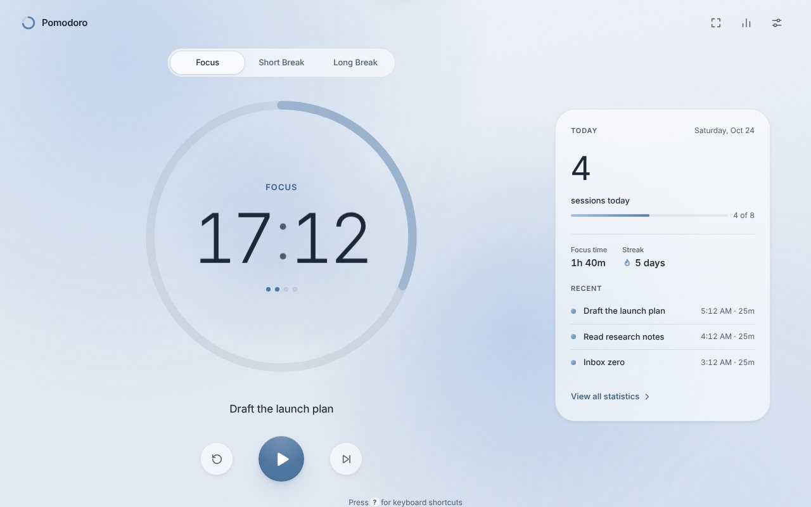

# Pomodoro Timer

A calm, premium Pomodoro timer for the web. Soft, faded colour worlds for each phase, a fluid progress ring, odometer digits and tactile micro‑interactions — in plain HTML, CSS and JavaScript with **no framework, no build step and no runtime dependencies**. It works offline and installs as an app on iOS, Android and desktop.

**Live:** https://coder-4847.github.io/Pomodoro-Timer/



## Features

- **Rock-solid timing.** The timer stores an absolute end timestamp and derives the remaining time from the clock every frame, so throttled tabs, sleeping laptops and locked phones never drift. On return it catches up instantly.
- **Survives refreshes.** The running timer is persisted. If a session ended while the app was closed, it is recorded at its real end time and you get a gentle “finished while you were away” note.
- **Focus, Short Break, Long Break**: 25 / 5 / 15 minutes by default, long break after every 4 focus sessions, all editable. Optional auto-start for breaks and focus.
- **Sessions today** is the hero stat (resets at local midnight; only completed focus sessions count), with cycle dots showing how close the long break is.
- **Task labels**: an inline “What are you focusing on?” field saved with each session.
- **Daily goal** (default 8) with a subtle progress bar and a tasteful celebration when you reach it.
- **Statistics**: today, this week (animated SVG bar chart of the last 7 days), current and longest streak, total focus time, daily average and recent sessions.
- **Sound**: soft chimes synthesised with the Web Audio API (distinct tones for focus end and break end, an optional tick). No audio files. Handles the iOS audio unlock.
- **Notifications, haptics and wake lock**: phase-end notifications (permission is only requested when you turn them on), vibration where supported, and the screen kept awake during focus.
- **Live tab**: the title shows `24:13 · Focus` and the favicon draws the live progress ring.
- **Focus (zen) mode**: everything fades away except the timer, in a staggered sequence.
- **Light / Dark / Auto** themes across three palettes (powder blue, butter, apricot) that cross-fade, gradients included, using `@property`.
- **Export / import** your data as JSON, and reset everything.
- **Accessible**: semantic landmarks, labelled controls, full keyboard support, focus trapping in dialogs, a screen-reader timer, polite announcements on phase changes only, WCAG AA contrast, and `prefers-reduced-motion` support.
- **Undo**: switching mode, skipping or resetting a timer in progress offers an Undo.

## Keyboard shortcuts

| Key | Action |
| --- | --- |
| `Space` | Start / pause |
| `R` | Reset |
| `S` | Skip to next phase |
| `1` `2` `3` | Focus · Short Break · Long Break |
| `Z` | Focus (zen) mode |
| `T` | Statistics |
| `,` | Settings |
| `?` | Shortcut cheat sheet |
| `Esc` | Close / exit |

## Install it as an app

- **iPhone / iPad (Safari):** tap **Share**, then **Add to Home Screen**. Notifications on iOS only work from the installed app.
- **Android (Chrome):** open the menu (⋮) and tap **Install app** (or **Add to Home screen**).
- **Desktop (Chrome / Edge):** click the install icon in the address bar, or open the menu and choose **Install Pomodoro Timer**.

Once installed (or after one visit), it works fully offline.

## Project structure

```
index.html              App shell, icon sprite, dialogs
manifest.webmanifest    PWA manifest
sw.js                   Service worker (versioned cache-first app shell)
css/
  tokens.css            Type, spacing, motion tokens and the six colour worlds
  base.css              Reset, backdrop, layout and responsive composition
  components.css        Ring, controls, panels, sheet, form controls, toasts…
  animations.css        Keyframes, load choreography, view transitions, reduced motion
js/
  main.js               Wiring: frame loop, render, choreography, shortcuts, zen, views
  timer.js              Timing engine (absolute timestamps, completion, auto-start)
  state.js              Versioned schema, validation, tiny reactive store
  storage.js            Safe localStorage with in-memory fallback
  ui.js                 Odometer, ring, play/pause morph, segmented control, layers, toasts
  fx.js                 Particle and ring-wave celebrations
  stats.js              Streaks and totals, Today panel and Statistics view (SVG chart)
  settings.js           Settings sheet, export/import, reset
  notify.js             Notifications, vibration, screen wake lock
  audio.js              Web Audio chimes
  tab.js                Dynamic title and canvas favicon
assets/                 Bundled Inter variable font, icons, store screenshots
tests/                  Playwright functional tests and visual sweep
tools/                  Icon and screenshot generators
```

## Development

There is no build step. Serve the folder with any static server:

```bash
npx http-server -p 8080 -c-1 -s .
# open http://localhost:8080
```

Tests use Playwright (Chromium):

```bash
npm install            # installs Playwright (dev only)
npm run serve &        # serve on :8080
npm test               # 20 functional checks: accuracy, sleep, restore, midnight, offline…
npm run screenshots    # every viewport × theme × mode into .screenshots/
```

## Deployment

Pushing to `main` runs `.github/workflows/pages.yml`, which copies only the app files into `_site`, stamps the service-worker cache with the commit SHA and deploys to GitHub Pages. Every path is relative, so the app works under the `/Pomodoro-Timer/` subpath.

One-time setup: **Settings → Pages → Build and deployment → Source: GitHub Actions**.

## License

MIT. The Inter font is © The Inter Project Authors, under the SIL Open Font License 1.1 (`assets/fonts/OFL.txt`).
